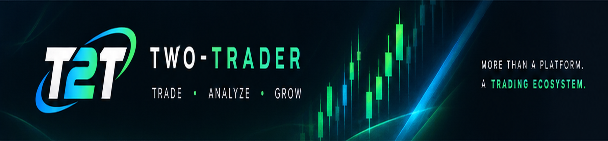

# T2T — TWO-TRADER

**MORE THAN A PLATFORM. A TRADING ECOSYSTEM.**

Twotrader (T2T) è una chain EVM decentralizzata costruita per il trading.
Niente payload opachi, niente "firma qualunque cosa". Ogni decisione che muove valore è un oggetto canonico con firme 3/5, deadline e veto.

## I 3 Pilastri

- 📈 **REAL MARKETS**: Trading reale, senza paura dei dump improvvisi o dei short manipolati.
- 🛠 **SMART TOOLS**: Il Canone delle Decisioni. Sicurezza e anti-scam by design.
- 🌍 **GLOBAL COMMUNITY**: Una rete governata dalla community, senza mano umana.

## Ecosistema

- **Chain ID Testnet:** 9818
- **Chain ID Mainnet:** 9819 (In arrivo)
- **Explorer:** [explorer-testnet.twotrader-scan.com](https://explorer-testnet.twotrader-scan.com/)
- **Sito Web:** [two-trader.com](https://two-trader.com)

## Documentazione

- [Stato del Progetto (PROJECT-STATE.md)](PROJECT-STATE.md)
- [Il Canone delle Decisioni (docs/CANON.md)](docs/CANON.md)
- [Guida per i Betatester (docs/BETA-GUIDE.md)](docs/BETA-GUIDE.md)

---
*TRADE • ANALYZE • GROW*
